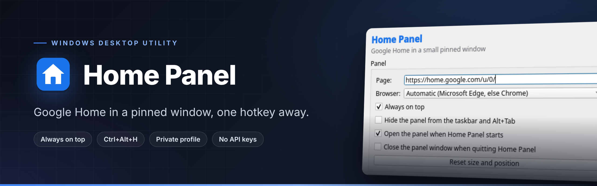
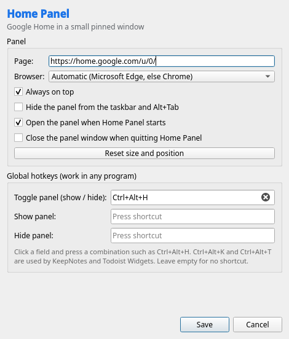
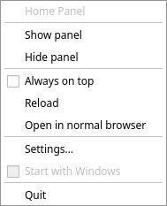

  

  
  
  
  
  

<h3 align="center">Turn off the lights without picking up your phone — Google Home in a small, always-on-top desktop window you summon with one hotkey.</h3>

  <a href="#-quick-start">Quick start</a> ·
  <a href="#-features">Features</a> ·
  <a href="#%EF%B8%8F-hotkeys">Hotkeys</a> ·
  <a href="#-configuration">Configuration</a> ·
  <a href="#-faq--troubleshooting">FAQ</a> ·
  <a href="#-roadmap">Roadmap</a> ·
  <a href="#-pro--coming-soon">Pro</a>

---

## ✨ Features

<table>
<tr>
<td width="33%" valign="top">

### 🏠 The real Google Home
Runs the official **home.google.com** web app — lights, plugs, thermostats, cameras and routines, exactly as Google ships them.

</td>
<td width="33%" valign="top">

### 📌 Pinned & compact
A clean app-mode window (no tabs, no address bar) that stays on top and remembers its size and position.

</td>
<td width="33%" valign="top">

### ⌨️ One hotkey
**Ctrl+Alt+H** shows or hides the panel from any program. Optional separate Show / Hide keys.

</td>
</tr>
<tr>
<td valign="top">

### 🔒 Private profile
Uses its own isolated Edge (or Chrome) profile. Your normal browser is untouched, and Home Panel never sees your password.

</td>
<td valign="top">

### 🛡️ No API keys, no debug ports
Works with any Google Home account — no Premium tier, developer project or remote-debugging port required.

</td>
<td valign="top">

### 🧭 Tray control
Blue house tray icon: left-click to toggle, right-click for Always on top, Reload, Open in browser, Settings and Start with Windows.

</td>
</tr>
<tr>
<td valign="top">

### 🖥️ Multi-monitor safe
If a monitor disappears, the panel is moved back on screen automatically.

</td>
<td valign="top">

### 🚀 Starts with Windows
One click in the tray menu — your home controls are ready when you log in.

</td>
<td valign="top">

### 🪶 Lightweight
A tiny PySide6 controller plus the browser you already have. No Electron bundle.

</td>
</tr>
</table>

## 📸 Screenshots

<table>
<tr>
<td align="center" width="60%"> Settings: page, browser, on-top, taskbar and hotkeys</td>
<td align="center" width="40%"> Tray menu</td>
</tr>
</table>

## 🚀 Quick start

**Requirements:** Windows 10/11, Python 3.11+ with the `py` launcher (`winget install Python.Python.3.12`) and Microsoft Edge (Google Chrome works as a fallback).

1. **Download** or clone this repository.
2. **Double-click `install.bat`.** It installs PySide6-Essentials for your user and adds a **Home Panel** Start Menu shortcut.
3. **Start it** from the Start Menu or with **`run.bat`** (no console window).
4. **Sign in once** with your Google account inside the panel, then open **Devices**. The sign-in is kept in the panel's own profile.

Prefer to do it by hand? `py -m pip install -r requirements.txt`, then `run.bat`.

## ⌨️ Hotkeys

| Action | Default | Where to change |
|---|---|---|
| Toggle panel (show / hide) | **Ctrl+Alt+H** | Settings → Global hotkeys |
| Show panel | — (optional) | Settings → Global hotkeys |
| Hide panel | — (optional) | Settings → Global hotkeys |
| Toggle panel | Left-click the tray icon | — |

Ctrl+Alt+T and Ctrl+Alt+K are used by the companion apps *Todoist Widgets* and *KeepNotes Widgets*, so they don't clash.

## 🛠 Configuration

Tray icon → **Settings…**

| Setting | Default |
|---|---|
| Page | `https://home.google.com/u/0/` (change `/u/0/` for another signed-in account) |
| Browser | Automatic — Microsoft Edge, else Chrome |
| Always on top | On |
| Hide the panel from the taskbar and Alt+Tab | Off |
| Open the panel when Home Panel starts | On |
| Close the panel window when quitting Home Panel | Off |
| Reset size and position | Button |

**Files** — all per user:

| Path | Contents |
|---|---|
| `%APPDATA%\HomePanel\settings.json` | Settings, window position |
| `%APPDATA%\HomePanel\homepanel.log` | Log file |
| `%LOCALAPPDATA%\HomePanel\EdgeProfile` | The panel's private browser profile (your Google sign-in) |

## ❓ FAQ & troubleshooting

<b>Why Edge and not an embedded browser?</b>

Google blocks sign-in inside embedded browsers such as Electron and QtWebEngine. Running the real Edge (or Chrome) in app mode with a separate profile is the reliable, Google-approved way to sign in — and it keeps your login secure.

<b>Do I need Google Home Premium or a developer account?</b>

No. Home Panel simply shows the regular Google Home web app, so it works with any account that can use home.google.com.

<b>Ctrl+Alt+H types a character / AltGr behaves oddly</b>

Windows treats **AltGr as Ctrl+Alt**. On layouts such as US-International, a global Ctrl+Alt+H also catches AltGr+H. If you use AltGr for special characters, pick another combination in Settings (e.g. Ctrl+Alt+Shift+H or Win+Alt+H).

<b>I closed the panel window — is it gone?</b>

No. Press the hotkey or choose **Show panel** in the tray menu and it opens again, still signed in.

<b>How do I uninstall?</b>

Run `uninstall.bat` (removes the shortcuts), then delete the app folder, `%APPDATA%\HomePanel` and `%LOCALAPPDATA%\HomePanel`.

## 🗺 Roadmap

- [ ] Compact "favourites" mode with only your most-used devices
- [ ] Per-room quick toggles from the tray menu
- [ ] Snap-to-edge docking
- [ ] Signed single-file installer (no Python required)
- [ ] Auto-update

## 💎 Pro — coming soon

> **Not available yet.** A Pro edition is being planned. Pricing and release date will be announced later.

Candidate Pro features: favourites mode, tray quick toggles, docking, a signed one-click installer and priority support. Interested? Watch this repository for updates.

## 📄 License

Proprietary software — **Copyright (c) 2026 GaryHman. All rights reserved.** See [LICENSE](LICENSE).

Google Home is a trademark of Google LLC; Microsoft Edge is a trademark of Microsoft Corporation. This project is not affiliated with Google or Microsoft.
